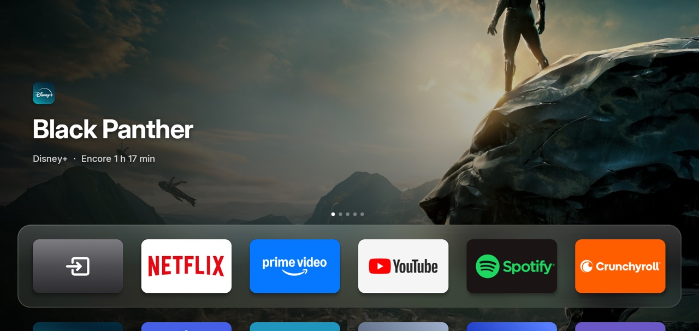
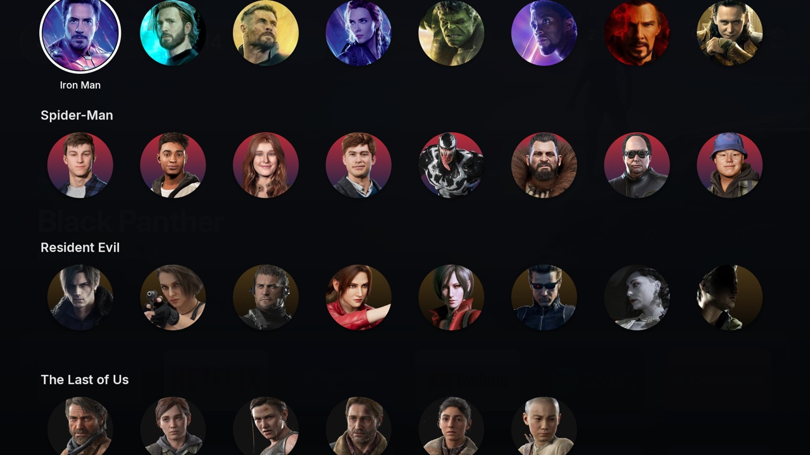
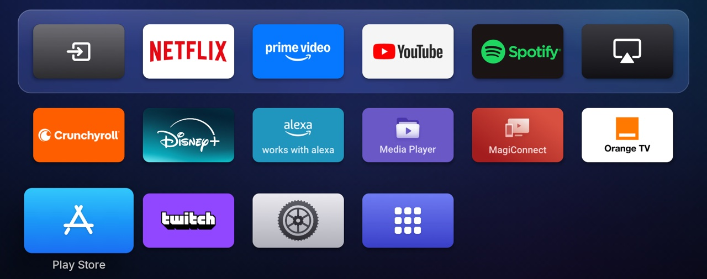
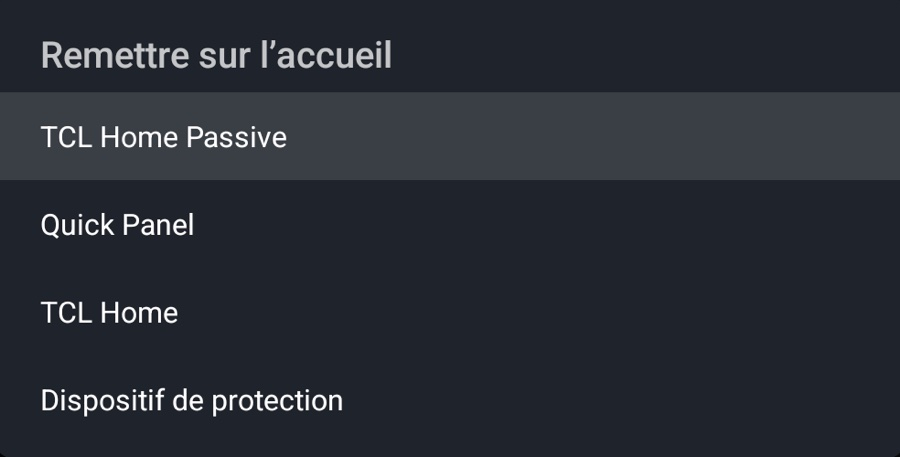

# Hume Launcher+

**Hume Launcher+** est une version modifiée de [Hume Launcher](https://github.com/petrobot-admin/hume-launcher)
(Petrobot), l'écran d'accueil façon Apple TV pour Android TV. Elle est adaptée à une **TV TCL sous Google TV
(Android 14)** et entièrement **en français** : sons plus doux, images « À reprendre » en HD, widget
PlayStation, avatars de personnages, tuiles façon Apple TV et apps alternatives sans pub.



La documentation du projet d'origine (fonctions, installation, architecture) est toujours valable :
**[docs/hume-original.md](docs/hume-original.md)**.

---

## Ce qui change par rapport à l'original

### Interface en français
Tous les textes affichés sur la TV sont traduits en tenant compte du contexte et de la place à
l'écran (« À suivre », « À reprendre », « Centre de contrôle », « Il y a 3 h », « Encore 12 min »…),
avec les nombres et les jours au format français (60,1 %, Sam., Dim.). La fonction *Libérer* du
Centre de contrôle reconnaît aussi le bouton « Forcer l'arrêt » d'une TV en français.

### Sons de navigation
Les « ding » d'Android sont remplacés par de petits sons doux, dans l'esprit de l'Apple TV : une tape
feutrée pour se déplacer, un « pop » rond pour valider, un autre plus grave pour revenir. Ils sont
synthétisés (aucun son copié) par [`tools/gen_sounds.py`](tools/gen_sounds.py) et se coupent avec le
réglage *Sons de navigation*.

Avec le service d'accessibilité de Hume activé, ces sons sont aussi joués dans les menus des autres apps
(Réglages de la TV, apps). Coupez alors les sons système de la TV pour ne pas avoir de double clic :

```sh
adb shell settings put system sound_effects_enabled 0
```

### « À reprendre » en haute définition
Les apps publient souvent de petites miniatures, floues une fois en plein écran. Hume cherche le titre
dans le catalogue Cinemeta et affiche à la place l'image de fond 1920×1080 et le logo du titre
([`HdArt.java`](src/com/petrobot/hume/HdArt.java)). L'image de l'app reste utilisée si rien n'est
trouvé. Chaque titre n'est cherché qu'une fois.

### Widget PlayStation
Une pastille à côté de la météo affiche le nombre de platines et la complétion moyenne. En
l'ouvrant : photo de profil, niveau, trophées par catégorie, jeux à 100 %, et rangs mondial et
national. Les données viennent de PSNProfiles, lu dans une WebView cachée : aucune connexion au
compte PlayStation n'est nécessaire. Tout ce qui n'est pas disponible est simplement masqué, sans trou
dans le panneau.

### Avatars de profils par saga
Les emojis sont remplacés par un sélecteur plein écran façon plateforme de streaming : une rangée par
saga (Marvel, Spider-Man, Resident Evil, The Last of Us, Zelda, Rap français), avec des portraits
recadrés sur le visage. On change d'avatar dans *Réglages → Profils → Avatar* ou par un appui long
sur un profil. Seules les images utilisées restent en mémoire.



### Apps et tuiles
- **YouTube sans pub** : la tuile YouTube lance [SmartTube](https://github.com/yuliskov/SmartTube)
  (sans pub, saut des passages sponsorisés) avec le vrai logo. L'app officielle part dans
  *Autres apps*.
- **Twitch** : même principe avec [SmartTwitchTV](https://github.com/fgl27/SmartTwitchTV).
- **Tuiles façon Apple TV** : *AirPlay* (l'app TV de la TCL, où arrive l'AirPlay), *Réglages* et le
  Play Store (style App Store), avec des logos dessinés en code.
- **Masquer complètement** : un appui long sur une app propose *Mettre dans Autres apps* ou
  *Masquer complètement*. Les apps masquées se retrouvent dans *Réglages → Accueil → Apps masquées*.
  Les utilitaires TCL (Safety Guard, Quick Panel, TCL Home…) sont masqués d'office.

### Touche Réglages de la télécommande
Sans l'accueil Google TV, la touche Réglages ne faisait plus rien (elle ouvrait son panneau latéral).
Elle ouvre maintenant le Centre de contrôle sur l'accueil Hume et, partout ailleurs (apps, HDMI), le
menu rapide de la TV (image, son, sortie audio, veille). Le Centre de contrôle a aussi un bouton rond
*Réglages TV* pour ce menu. Il faut activer le service d'accessibilité de Hume
(*Paramètres → Accessibilité → Hume Launcher+*), qui ne garde que cette touche. Sur une TCL, autorisez
aussi son démarrage automatique, sinon la TV refuse de lancer le service :

```sh
adb shell appops set com.petrobot.hume AUTO_START allow
```





### Liquid Glass
Les boutons et pastilles du haut ont un verre neutre (ils ne prennent plus la couleur de l'image
derrière), un liseré plus fin à leur échelle, et de la place pour grossir au focus sans être rognés.

---

## Ce qu'il faut faire pour que tout marche

### 1. Outils pour compiler
- **JDK 17** (pas plus récent : `d8` plante avec les JDK 25+).
  Sur Mac : `brew install openjdk@17`, puis
  `export JAVA_HOME=/opt/homebrew/opt/openjdk@17/libexec/openjdk.jdk/Contents/Home`.
- **Android SDK** : `build-tools;34.0.0` et `platforms;android-34`.

### 2. Votre identifiant PSN par défaut (facultatif)
Le pseudo PSN n'est pas dans le dépôt. Pour qu'il soit déjà rempli dans votre build :

```sh
cp personal.example.json assets/personal.json   # puis mettez votre ID PSN dedans
```

`assets/personal.json` est ignoré par git. Sans ce fichier, l'ID se saisit dans
*Réglages → PlayStation → ID PSN*. Les trophées du compte doivent être **publics** et le profil doit
exister sur [PSNProfiles](https://psnprofiles.com) (il suffit d'y chercher le pseudo une fois).

### 3. Les avatars (Mac uniquement)
Les images des personnages appartiennent à leurs ayants droit : elles ne sont **pas** dans le dépôt
et se génèrent localement avant la compilation :

```sh
python3 tools/fetch_avatars.py
```

Le script télécharge les images listées dans [`tools/avatars.json`](tools/avatars.json), les recadre
sur le visage avec la détection de visages d'Apple (`swift`, d'où le Mac), et écrit
`assets/avatars/`. Les wikis Fandom refusent les téléchargements automatiques : pour ces images,
enregistrez-les vous-même dans `tools/.avatar_cache/` sous le nom `<saga>_<id>`, sans extension
(par exemple `zelda_link`), puis relancez le script. Une image absente est simplement ignorée, et
sans aucun avatar les profils gardent leurs emojis.

### 4. Compiler et installer

```sh
./build.sh                                        # → build/tvos-home.apk
adb connect <IP-de-la-TV>:5555
adb install -r build/tvos-home.apk
adb shell pm set-home-activity com.petrobot.hume/.MainActivity
```

La TV doit avoir le **débogage réseau** activé. Le build est signé avec une clé locale
(`debug.keystore`, ignorée par git) : **gardez-la**, car Android n'installe une mise à jour que si
elle est signée avec la même clé. Sinon, il faut désinstaller avant de réinstaller (les réglages de
Hume sont alors perdus). Plus de détails : [docs/install.md](docs/install.md).

Sur cette TCL, l'accueil Google TV reprend la main sur le bouton Accueil. La façon la plus simple
est de le désactiver :

```sh
adb shell pm disable-user --user 0 com.google.android.apps.tv.launcherx
adb shell pm disable-user --user 0 com.google.android.tungsten.setupwraith
```

Pour revenir en arrière : `pm enable` sur ces deux paquets, puis
`pm set-home-activity com.google.android.apps.tv.launcherx/.home.HomeActivity`.

### 5. Les apps alternatives
Installez-les depuis leurs pages GitHub officielles (APK `armeabi-v7a` pour une TV 32 bits) :
- SmartTube : <https://github.com/yuliskov/SmartTube/releases>
- SmartTwitchTV : <https://github.com/fgl27/SmartTwitchTV/releases>

Hume les détecte tout seul et leur donne l'apparence de YouTube et de Twitch.

### 6. AirPlay
Les TCL récentes ont **AirPlay 2 intégré** : rien à installer. La TV apparaît dans *Recopie de
l'écran* sur iPhone et dans le Centre de contrôle sur Mac. N'installez pas d'autre serveur AirPlay en
parallèle, ils entrent en conflit sur le même port.

---

## Spécifique à cette TV
Quelques réglages visent une TCL : le nom et la tuile *AirPlay* (app `com.tcl.tv`) et la liste des
utilitaires TCL masqués par défaut (`REMOVED_BY_DEFAULT` dans
[`MainActivity.java`](src/com/petrobot/hume/MainActivity.java)). Sur une autre marque, ils sont
simplement sans effet.

## Licence et crédits
Apache License 2.0, comme le projet d'origine : voir [LICENSE](LICENSE) et [NOTICE](NOTICE). Chaque
fichier modifié ou ajouté par ce fork l'indique sur sa première ligne, avec un résumé des changements.
Hume Launcher est créé par [Petrobot](https://github.com/petrobot-admin/hume-launcher). SmartTube,
SmartTwitchTV, PlayStation, PSNProfiles, Apple, AirPlay et les personnages des avatars appartiennent
à leurs propriétaires respectifs. Hume Launcher+ n'est affilié à aucun d'entre eux, ni à Petrobot.
